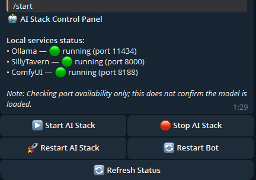
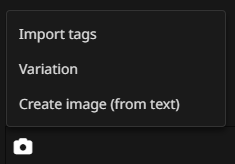
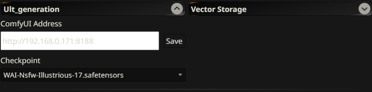
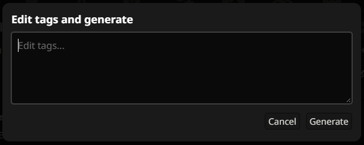

# NoPaywall_AI_Roleplay

**NoPaywall_AI_Roleplay** is a fully local, self-hosted AI roleplay and image generation stack for Windows. It is designed to give you complete control over your AI interactions without relying on paid cloud services. Everything runs on your own hardware, ensuring privacy and zero subscription costs.

This stack combines text generation (Ollama), a powerful web interface (SillyTavern), and local image generation (ComfyUI), all controlled via a Telegram bot for convenience.

## 📸 Screenshots

| Telegram Bot Control | SillyTavern Extension Menu |
| :---: | :---: |
|  |  |

| Extension Settings | Tag Editing Modal |
| :---: | :---: |
|  |  |

## 📦 Components & Credits

This project stands on the shoulders of giants. Huge thanks to the original authors:

### Core Applications
*   **SillyTavern**: The frontend for interacting with LLMs. [GitHub](https://github.com/SillyTavern/SillyTavern) | [Docs](https://docs.sillytavern.app/). Licensed under **AGPL-3.0**.
*   **ComfyUI**: The node-based GUI for Stable Diffusion. [GitHub](https://github.com/comfyanonymous/ComfyUI) | [Portable Download](https://github.com/comfyanonymous/ComfyUI/releases/latest/download/ComfyUI_windows_portable_nvidia.7z). Licensed under **GPL-3.0**.
*   **Ollama**: The local LLM runner. [Website](https://ollama.com/). Licensed under **MIT**.

### Models Used
*   **Text Generation**: [Ministral-3-8B-Nymphaea-RP](https://huggingface.co/0xA50C1A1/Ministral-3-8B-Nymphaea-RP) by `0xA50C1A1`. Licensed under **Apache-2.0**.
*   **Image Generation (Checkpoint)**: [WAI-NSFW-Illustrious-17](https://tensor.art/models/990778216270553015) by WAI0731. License: **CreativeML OpenRAIL-M** (via base model). The author permits commercial use of generated images but prohibits reselling the model itself.
*   **Tagging Models**: `wd-eva02-large-tagger-v3` (auto-downloaded) and [v2ray/deepgelbooru](https://huggingface.co/v2ray/deepgelbooru) by v2ray. DeepGelbooru is licensed under **MIT**.

### Custom Nodes & Extensions
*   **SillyTavern Image Extension**: Based on [Image-gen-kazuma](https://github.com/Arif-salah/Image-gen-kazuma) by Arif-salah. Licensed under **MIT**. (Heavily modified in this repo to support the dual-tagger workflow and API structure).
*   **ComfyUI Node (WD Tagger)**: [ComfyUI-WD-Timm-Tagger](https://github.com/bedovyy/ComfyUI-WD-Timm-Tagger) by bedovyy. Licensed under **MIT**.
*   **ComfyUI Node (ImgUtils)**: [comfyui-imgutils](https://github.com/xiaden/comfyui-imgutils) by xiaden. Licensed under **MIT**.

---

## 🚀 Installation Guide

### Prerequisites
*   Windows 10/11
*   NVIDIA GPU (RTX 3070 Ti or better recommended for 8GB VRAM)
*   Node.js (LTS version) for SillyTavern
*   Git (optional, but recommended)

### Step 1: Install SillyTavern
1.  Clone the repository into a folder (e.g., `E:\AI\SillyTavern`):
    ```bash
    git clone https://github.com/SillyTavern/SillyTavern -b release

*   **Boosty:** [https://boosty.to/wetlabac](https://boosty.to/wetlabac)
*   **Tribute:** [https://web.tribute.tg/e/1Pz](https://web.tribute.tg/e/1Pz)

Your support helps keep the project alive and free for everyone.
